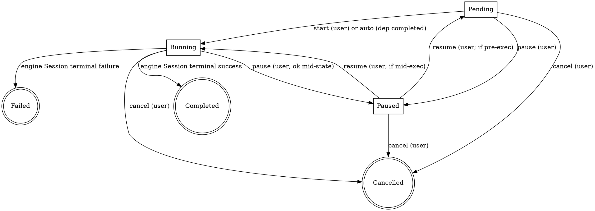

# Creator Schedule and Core Context — Specification

**Status**: Shipped — schedule lifecycle and immutable versioned `core_context`; cross-referenced from [orchestration-engine.md](orchestration-engine.md).  
**Document class**: Master  
**Scope**: Multi-Schedule lifecycle per creator + the immutable versioned `core_context` that stabilises preset execution across edits.  
**Coordinates with**:

- [orchestration-engine.md](orchestration-engine.md) — Task/Capability/Session primitives this spec builds on
- [schemas-external-consumer-boundary.md](../architecture/schemas-external-consumer-boundary.md) — confirms Schedule / core_context types are **local** (not wire)

**Answers for open questions parked in [orchestration-engine.md](orchestration-engine.md) §11**: OQ-1, OQ-2, OQ-3, OQ-4, OQ-5 are resolved here (see §2 "Confirmed Decisions"); OQ-6 (cron / wall-clock triggers) is implemented (§13); OQ-7/OQ-8 are deferred (§13).

---

## Table of Contents

1. [Problem Statement](#1-problem-statement)
2. [Confirmed Decisions (locked)](#2-confirmed-decisions-locked)
3. [Data Model](#3-data-model)
4. [Schedule Lifecycle and State Machine](#4-schedule-lifecycle-and-state-machine)
5. [Multi-Schedule Concurrency (per creator)](#5-multi-schedule-concurrency-per-creator)
6. [`core_context` Derivation and Versioning](#6-core_context-derivation-and-versioning)
7. [Preset YAML Additions](#7-preset-yaml-additions)
9. [HTTP Surface (`/v1/daemon/orchestration/schedules*`)](#9-http-surface-v1daemonorchestrationschedules)
10. [SQLite Schema Additions](#10-sqlite-schema-additions)
11. [LLM-Summarize Iteration](#11-llm-summarize-iteration)
13. [Open Questions Deferred](#13-open-questions-deferred)
14. [References](#14-references)

---

## 1. Problem Statement

The orchestration engine ([orchestration-engine.md](orchestration-engine.md)) ships a `Session` primitive that can run one preset to completion. It does **not** answer:

1. **When** should the daemon start running preset `X` for creator `C`? ("daemon knows when to begin")
2. **What** does a user see when asking "what does my creator have planned for the next while?"
3. **How** does the user inject, modify, append, or delete the prompts that drive a pending / in-flight preset run? ("CRUD by ID")
4. **How** does preset execution stay stable against user edits? ("core_context 需要是稳定的")
5. **How** does each preset run's `core_context` evolve beyond the raw seed — into the actually-prompted "core context" the agent sees?

This document answers those five questions by defining **Creator Schedule** (queue of planned preset runs, user-visible, CRUD-able) and **`core_context`** (immutable versioned prompt state that the engine reads at execution boundaries).

## 2. Confirmed Decisions (locked)

- **Multi-Schedule per creator is supported** — one creator may have multiple Schedules.
- **Concurrency is declared per-add** — `concurrency: ParallelWith` (or `ParallelAny` / `Serial`) is declared when the Schedule is added; default is serial (FIFO queued after existing Schedules of the same creator).
- **No priority / preemption** — only explicit `schedule pause / resume / cancel` signal operations. Running Schedules are not interrupted by new higher-priority Schedules; if the user wants re-ordering, they must `pause` then add then `resume`.
- **When all Schedules complete, creator returns to idle** — no hidden default loop (the `_system.maintenance` preset handles system housekeeping, which is not per-creator).
- **In-flight input edits are accepted but do not preempt the current execution** — a user core-context edit (§9) writes a new `core_context` version; the running `Session` finishes the **current state's enter actions + exit evaluation** on the previous version and picks up the new version at the **next state transition**. This preserves the "core_context is stable during execution" guarantee while honouring user intent on the next cycle.
- **`core_context` is immutable-versioned** — every derivation step produces a new `core_context_version` row; the Schedule holds a pointer to the current version; history is user-queryable.
- **`iterated_experience` derivation is the preset `context_update` hook plus the `context.summarize` capability** — the capability (`crates/nexus-orchestration/src/capability/builtins/context_summarize.rs`) writes the reserved `kind: "llm_summarize"` derivation without schema migration.
- **Seed → first `core_context` semantics governed by preset** — preset YAML declares the initial-action behaviour; built-in presets default to "seed content becomes `core_context` v0 verbatim"; a preset may declare a one-shot LLM expansion step and the engine will execute it. **Durable roadmap:** DR-17.
- **Trigger model**: on-demand triggers (`schedule start`, auto-advance, `timer.wait_until`) plus wall-clock / cron triggers via a hand-rolled clock poller in `crates/nexus-orchestration/src/scheduler/` using `cron` + `chrono-tz` (see [`crate-selection-best-practices.md`](../../../knowledge/crate-selection-best-practices.md) §2.7 for the four hard constraints this implementation satisfies).
- **Schedule and core_context types are local** — per [schemas-external-consumer-boundary.md](../architecture/schemas-external-consumer-boundary.md) §2, platform never observes these; they live as hand-coded Rust in `crates/nexus-contracts/src/local/schedule/` (or the appropriate local submodule).
- **Auto-chain side-input** — inspiration append (`creator works inspire --note`, agent `nexus.work.patch`) and research KB writes during an active FL-E driver schedule produce new `core_context` versions or external KB artifacts but **must not** create a second active stage driver or cancel the current one. The running session completes the current state on the prior snapshot; enriched context is visible at the **next** state transition. See [creator-workflow.md](../creator/creator-workflow.md) §5.5.

## 3. Data Model

### 3.1 `Schedule`

```rust
// crates/nexus-contracts/src/local/schedule/mod.rs

pub struct Schedule {
    pub id: ScheduleId,                       // ULID, user-addressable
    pub creator_id: CreatorId,
    pub preset_id: String,                    // e.g. "novel-writing"
    pub preset_version: u32,                  // snapshot of the preset at add-time
    pub status: ScheduleStatus,
    pub concurrency: ScheduleConcurrency,
    pub depends_on: Vec<ScheduleId>,          // predecessor Schedules (must be completed/cancelled before this starts)
    pub current_core_context_version: CoreContextVersion,
    pub current_session_id: Option<SessionId>,// set while executing; None when pending/paused/completed
    pub scheduled_at: Option<Timestamp>,      // nullable; clock-trigger field
    pub label: Option<String>,                // optional user-friendly name
    pub created_at: Timestamp,
    pub updated_at: Timestamp,
    pub terminated_at: Option<Timestamp>,
}

pub enum ScheduleStatus {
    Pending,      // not yet started; waiting on deps or user `schedule start`
    Running,      // current_session_id is an active Session
    Paused,       // user paused; current_session_id may be Some (mid-execution) or None (pre-exec)
    Completed,    // terminal success
    Cancelled,    // terminal cancel (user or cascade)
    Failed,       // terminal failure (preset hit unrecoverable error)
}

pub enum ScheduleConcurrency {
    Serial,                                   // default — queued behind existing non-terminal Schedules
    ParallelWith(Vec<ScheduleId>),            // may run concurrently with these specific Schedules
    ParallelAny,                              // may run concurrently with any sibling Schedule of this creator (escape hatch; use sparingly)
}
```

### 3.2 `CoreContext`

```rust
// crates/nexus-contracts/src/local/schedule/core_context.rs

pub struct CoreContextVersion(pub u32);       // strictly increasing per Schedule; v0 is initial

pub struct CoreContextRecord {
    pub schedule_id: ScheduleId,
    pub version: CoreContextVersion,
    pub content: CoreContextPayload,          // the "what preset execution actually sees"
    pub derivation: DerivationStep,           // what made this version
    pub created_at: Timestamp,
    pub created_by: CoreContextAuthor,
}

pub enum CoreContextPayload {
    /// Flat text form. Preset inserts `{{core_context.text}}` into prompts.
    Text { body: String },
    /// Structured form (optional for presets that want it). Preset accesses
    /// specific fields via `{{core_context.struct.key}}`.
    Struct { body: serde_json::Value },
}

pub enum DerivationStep {
    Seed { raw: String },                                     // v0 — from `schedule add --seed`
    UserEdit { op: EditOp, source_user: Option<UserId> },     // user modify/append/delete
    PresetHook { state_id: String, hook_name: String },       // preset declared context_update hook fired
    #[non_exhaustive]
    LlmSummarize { capability: String, prompt_hash: [u8;32] }, // emitted by the context.summarize capability
    PresetSeedExpansion { capability: String },                // preset initial_action_kind: llm_expand (rare)
}

pub enum EditOp {
    Replace { body: String },                 // overwrite text
    Append { body: String },                  // append text
    StructMerge { patch: serde_json::Value }, // JSON-merge into struct payload
    StructRemove { path: String },            // remove a struct key
}

pub enum CoreContextAuthor {
    User { id: UserId },
    System,                                   // preset hook / engine internal
}
```

### 3.3 Relationship to `orchestration_sessions`

The orchestration engine's `Session` (from [orchestration-engine.md](orchestration-engine.md) §4.3) **does not change**. A Schedule **owns zero or one active Session** at a time:

- `Schedule.status = Pending | Paused (pre-exec)` ⇒ no Session yet.
- `Schedule.status = Running` ⇒ `Schedule.current_session_id` points at an active row in `orchestration_sessions`.
- `Schedule.status = Paused (mid-exec)` ⇒ the Session exists and its engine status is `paused`; the Schedule is also marked Paused for user visibility.
- Terminal statuses (`Completed | Cancelled | Failed`) ⇒ Session has reached its terminal graph-flow state; Session row remains for history.

At each **outer state transition** inside the engine, the `AcpPromptTask` / `CapabilityTask` reads the Schedule's `current_core_context_version` once. A user's core-context edit between transitions bumps the version but **does not** interrupt the in-flight state; the next transition picks up the new version. This is the mechanism that satisfies "core context 需要是稳定的（执行时）" while allowing user edits.

## 4. Schedule Lifecycle and State Machine



Rules:

- Only the engine's Session terminal events flip a Schedule to `Completed` / `Failed`. The engine signals the Schedule supervisor (`nexus-orchestration`).
- `cancel` is always available non-terminally; it cascades to the active Session via `engine.signal(session, Cancel)` ([orchestration-engine.md](orchestration-engine.md) §4.5).
- A Schedule's dependency set (`depends_on`) gates `Pending → Running`: the Schedule cannot auto-start until every dep is `Completed` or `Cancelled`. A `Failed` dependency blocks auto-start (escalates to user: "dependency failed; resolve or remove").

## 5. Multi-Schedule Concurrency (per creator)

### 5.1 Scheduler logic

The Schedule supervisor (new in `nexus-orchestration`) maintains a per-creator queue. On any state change that could unlock progress (new Schedule added, current Schedule completed, user cancel, user pause/resume), it recomputes:

- Eligible Schedules: `status == Pending` AND all `depends_on` satisfied.
- Currently running set: Schedules whose `status == Running`.
- Concurrency admission:
  - `Serial` eligible ⇒ admit only if the currently running set is empty OR the running set's Schedules are all listed in this Schedule's `ParallelWith` / compatible `ParallelAny`.
  - `ParallelWith(ids)` eligible ⇒ admit if every currently running Schedule is in `ids` (or running set is empty).
  - `ParallelAny` eligible ⇒ always admit, subject to the worker single-session limit (§5.2).
- Admission order within a compatibility group: FIFO by `created_at`.

### 5.2 Single-worker-per-creator constraint

Per [orchestration-engine.md](orchestration-engine.md) §6.2, one creator has one ACP worker subprocess, and that worker holds **one** ACP session. This puts a hard cap on **parallel ACP-calling** Schedules for the same creator:

- At most **one** Schedule is doing `acp.prompt` at any instant for a given creator.
- A `ParallelWith` / `ParallelAny` admission is architecturally legal, but if both running Schedules hit an `acp.prompt` node at the same wall-clock tick, the second one enters a per-creator "ACP busy" queue (short wait, not a pause).
- Capability-only Schedules (no ACP; e.g. pure `sync.*` / `workspace.*` / `outbox.*`) can run fully parallel because they don't touch the worker.

This constraint is implemented at the `AcpPromptTask` dispatch site (a per-creator mutex around the worker's `worker/acp_prompt` IPC call).

### 5.3 Inter-Schedule hand-off (`depends_on` without serial gate)

If the user wants Schedule B to auto-start **immediately** after Schedule A terminates (success only), B is declared with `depends_on: [A]` and `concurrency: Serial` (the supervisor then picks B up as soon as A terminates). For "after A OR on user demand, whichever comes first", B is declared with `depends_on: [A]` but stays eligible for manual start.

## 6. `core_context` Derivation and Versioning

### 6.1 Version sequence per Schedule

Every Schedule has a strictly-increasing `CoreContextVersion` sequence beginning at v0. Each version row in `core_context_versions` is **immutable** once written. The Schedule's `current_core_context_version` column points at the head.

### 6.2 Derivation kinds (implemented)

- **`Seed`** — written when the Schedule is added. Content = `--seed` argument verbatim (for built-in presets that declare the default initial action). Version = 0.
- **`UserEdit`** — written whenever a user applies a valid `EditOp` via the core-context edit surface (§9). `Replace` is allowed — users retain full control, whereas preset hooks are append-only. Edits on terminal-status Schedules are rejected; edits on running Schedules take effect at the next state transition (§3.3, §6.4). Version = prev + 1.
- **`PresetHook`** — written when a preset declares a `context_update` hook on a state's `exit` and that state exits successfully. Hooks are **strictly additive**: only `EditOp::Append` or `EditOp::StructMerge` are valid; a hook cannot replace or remove. Version = prev + 1.
- **`PresetSeedExpansion`** — written when the Schedule is added and the preset declares `initial_action: llm_expand` (opt-in per preset). Content = result of a one-shot LLM capability call over the raw seed. Built-in presets do **not** declare this; the plumbing exists so external-preset authors can opt in.

### 6.3 `LlmSummarize` derivation kind

- **`LlmSummarize`** — the `context.summarize` capability (`crates/nexus-orchestration/src/capability/builtins/context_summarize.rs`) emits this derivation kind. The enum is `#[non_exhaustive]` and the JSON serialized form uses tagged enums, so the addition required no schema migration. Storage and query endpoints handle this variant.

### 6.4 What the engine actually prompts with

When a `CapabilityTask` or `AcpPromptTask` renders a Handlebars template, the following variables are bound **from the current `core_context` snapshot at the start of the state** (not per-node):

- `{{core_context.text}}` — the text body (if payload kind is `Text`).
- `{{core_context.struct.<path>}}` — dotted-path lookup (if payload kind is `Struct`).
- `{{core_context.version}}` — numeric version, useful in logs.

The snapshot does not change mid-state. A `UserEdit` during a state's execution creates a new version, but the **current state finishes** on the old snapshot; the **next** state's `enter` evaluates template bindings against the new version.

### 6.5 Queryable history

Users can inspect the full derivation trace via HTTP (§9). The history shows each version with:

- Version number
- Derivation kind (user-visible label: "seed", "user edit", "preset hook", "preset seed expansion", "LLM summarise")
- Edit summary (one line: "appended 14 tokens", "replaced", "summarised", …)
- `created_at`
- `created_by` (user id or "system")

The **content** of historical versions is returned on request; by default only the meta-rows are shown to keep the output readable.

### 6.6 SOUL Experience aggregation

The `## Experience` section in SOUL.md is **derived from long-term memory files**, not hand-authored. Two paths update it:

1. **CLI one-shot** — `nexus42 creator soul refresh-experience` runs deterministic aggregation (no LLM): reads all long-term memory files, filters to experience-kind entries (`story_summary`, `review_note`, `character_note`, `world_building`, `plot_outline`, `theme_analysis`), sorts by recency, and concatenates excerpts into the `## Experience` section. Hand-edits under `## Experience` are overwritten on each refresh.

2. **Orchestration capability + preset** — the `soul.experience.aggregate` capability (registered in `CapabilityRegistry`) performs the same deterministic aggregation and can be invoked from the `soul-experience-refresh` embedded preset. Schedule a cron trigger for periodic automated refresh. If LLM polish is desired, chain `context.summarize` in a subsequent step within the preset.

Implementation: `nexus-creator-memory::experience_aggregation` (core logic), `nexus42 creator soul refresh-experience` (CLI entry), `nexus-orchestration::capability::builtins::soul_experience_aggregate` (orchestration capability).

## 7. Preset YAML Additions

Extensions to the preset bundle format ([orchestration-engine.md](orchestration-engine.md) §7.2). These are **additive** and optional — presets without these fields behave as if they had the defaults.

### 7.1 `initial_action` (preset root)

Declares how the seed becomes `core_context` v0.

```yaml
preset:
  id: novel-writing
  version: 1
  initial_action:
    kind: seed_direct           # default; seed content becomes core_context v0 verbatim
  # OR:
  initial_action:
    kind: seed_expansion
    capability: judge.llm
    template_file: prompts/seed-expansion.md
    payload_kind: text          # or: struct
```

Built-in presets (`_system.maintenance`, `novel-writing`) use `kind: seed_direct` (default; can be omitted).

### 7.2 `context_update` hook on a state

Declares that when this state's `exit_when` fires (success path), a `PresetHook` derivation writes a new `core_context` version:

```yaml
states:
  - id: outlining
    enter: [ … ]
    exit_when:
      kind: manual
    next: drafting
    context_update:              # NEW; optional
      op: append                 # or: struct_merge
      template_file: prompts/outlining-context-update.md
      # prompt template can use {{state.outlining.output}}, {{core_context.*}}, etc.
```

The engine evaluates the template at state exit, runs the declared `EditOp`, and persists a new `core_context_versions` row with `kind: PresetHook`.

### 7.3 `seed_schema` (preset root, optional)

Describes the shape of the seed argument so `--seed-file` JSON can be validated before the Schedule row is created. Not required; built-in presets accept free text.

```yaml
preset:
  seed_schema:
    kind: struct
    fields:
      topic: { type: string, required: true }
      vibe:  { type: string, default: literary }
```

## 9. HTTP Surface (`/v1/daemon/orchestration/schedules*`)

The served endpoints (control surface served by [`apps/nexus-service`](../../../../apps/nexus-service/src/execution.ts) over `nexus-core`; `EXECUTION_ROUTES` in that module is the exact served set):

| Method | Path                                                                  | Purpose                                                     |
| ------ | --------------------------------------------------------------------- | ----------------------------------------------------------- |
| GET    | `/v1/daemon/orchestration/schedules`                                   | List Schedules; filters `?creator_id=`, `?status=`, `?sort=`, `?cursor=`, `?limit=` |
| GET    | `/v1/daemon/orchestration/schedules/{schedule_id}`                     | Schedule detail (`schedule` summary + `depends_on` + `concurrency_kind`) |
| POST   | `/v1/daemon/orchestration/schedules`                                   | Add Schedule                                                |
| PATCH  | `/v1/daemon/orchestration/schedules/{schedule_id}/core-context`        | Apply `EditOp` (user edit)                                  |
| POST   | `/v1/daemon/orchestration/schedules/{schedule_id}/signal`              | `{signal: pause\|resume\|cancel}`                           |

**Not served:** `GET .../{schedule_id}/core-context`, `GET .../{schedule_id}/core-context-history`, `DELETE .../{schedule_id}` and the schedule label mutation are not routed; they keep the truthful `501 route_not_migrated` refusal (`apps/nexus-service/src/server.ts`) rather than a degraded fake. The signal route does not serve `start` / `advance` / `continue` either — the core signal seam refuses them as `InvalidInput` (`crates/nexus-core/src/execution/handle_ops.rs`), and no other served route accepts them. A successful signal returns `{schedule_id, status, current_wait_id?}`.

Per [schemas-external-consumer-boundary.md](../architecture/schemas-external-consumer-boundary.md) §2, these request/response types are **local** (platform never observes them). Request/response Rust types live in `crates/nexus-contracts/src/local/schedule/http.rs` — hand-written, no JSON Schema file.

## 10. SQLite Schema Additions

Migration under `crates/nexus-local-db/migrations/` (coordinated with the orchestration_sessions migration from [orchestration-engine.md](orchestration-engine.md) §4.3):

```sql
CREATE TABLE IF NOT EXISTS creator_schedules (
  schedule_id              TEXT PRIMARY KEY,                     -- ULID
  creator_id               TEXT NOT NULL,
  preset_id                TEXT NOT NULL,
  preset_version           INTEGER NOT NULL,
  status                   TEXT NOT NULL,                        -- pending|running|paused|completed|cancelled|failed
  concurrency_kind         TEXT NOT NULL,                        -- serial|parallel_with|parallel_any
  concurrency_whitelist    TEXT,                                 -- JSON array of schedule_ids (for parallel_with)
  current_core_context_version INTEGER NOT NULL DEFAULT 0,
  current_session_id       TEXT,                                 -- FK to orchestration_sessions(session_id), nullable
  scheduled_at             INTEGER,                              -- nullable; clock trigger
  label                    TEXT,
  created_at               INTEGER NOT NULL,
  updated_at               INTEGER NOT NULL,
  terminated_at            INTEGER,
  FOREIGN KEY (current_session_id) REFERENCES orchestration_sessions(session_id)
);

CREATE INDEX creator_schedules_by_creator   ON creator_schedules(creator_id, status);
CREATE INDEX creator_schedules_by_status    ON creator_schedules(status);
CREATE INDEX creator_schedules_by_scheduled ON creator_schedules(scheduled_at) WHERE scheduled_at IS NOT NULL;

CREATE TABLE IF NOT EXISTS schedule_dependencies (
  schedule_id              TEXT NOT NULL,
  depends_on               TEXT NOT NULL,
  PRIMARY KEY (schedule_id, depends_on),
  FOREIGN KEY (schedule_id) REFERENCES creator_schedules(schedule_id) ON DELETE CASCADE,
  FOREIGN KEY (depends_on)  REFERENCES creator_schedules(schedule_id)
);

CREATE TABLE IF NOT EXISTS core_context_versions (
  schedule_id              TEXT NOT NULL,
  version                  INTEGER NOT NULL,
  payload_kind             TEXT NOT NULL,                        -- text|struct
  content                  BLOB NOT NULL,                        -- serialized CoreContextPayload
  derivation_kind          TEXT NOT NULL,                        -- seed|user_edit|preset_hook|preset_seed_expansion|llm_summarize
  derivation_detail        BLOB,                                 -- serialized DerivationStep (op details, template hash, …)
  created_at               INTEGER NOT NULL,
  created_by_kind          TEXT NOT NULL,                        -- user|system
  created_by_user_id       TEXT,                                 -- nullable; set when created_by_kind='user'
  PRIMARY KEY (schedule_id, version),
  FOREIGN KEY (schedule_id) REFERENCES creator_schedules(schedule_id) ON DELETE CASCADE
);

CREATE INDEX core_context_versions_by_schedule ON core_context_versions(schedule_id, version DESC);
```

**Migration safety**: additive only; no existing tables touched. The engine continues to function with no Schedules.

## 11. LLM-Summarize Iteration

The LLM-driven `core_context` iteration handover is shipped: the reserved `LlmSummarize` derivation kind and the `context.summarize` capability emit new `core_context_versions` rows with `derivation_kind = 'llm_summarize'`, with no schema migration and no change to the HTTP envelope (§6.3). The original forward-compatibility preview is frozen in [`2026-09-21-creator-schedule-cli-and-delivery-history-historical-notes.md`](../../archived/orchestration/2026-09-21-creator-schedule-cli-and-delivery-history-historical-notes.md).

### 11.1 What the capability adds

- New capability `context.summarize` (`crates/nexus-orchestration/src/capabilities/context_summarize.rs`) that takes (current `core_context`, state execution trace, optional template) and writes a new `core_context_versions` row with `derivation_kind = 'llm_summarize'`.

## 13. Open Questions Deferred

### OQ-7 — Multi-agent per creator

Deferred. If users want two different ACP agents driving the same creator in parallel, Schedule admission can describe the intent (`ParallelAny` with different preset agents), but the worker model can't execute it; a future iteration either multiplexes one worker or spawns sibling workers.

> **Durable roadmap:** DR-09 (multi-agent per creator).

### OQ-8 — User-authored capabilities

Deferred. Schedule-level policy (who can author a preset that invokes a capability the service doesn't ship?) is out of scope; the built-in registry is the only source of capabilities.

> **Durable roadmap:** DR-10 (user-authored capabilities).

### OQ-6-extension — Cron / wall-clock triggers

The `scheduled_at` column and the clock poller move `Pending` Schedules to `Running` when `now() >= scheduled_at` (subject to admission rules). Implemented in `crates/nexus-orchestration/src/scheduler/`; no schema migration is required.

### OQ-S2 from schemas-boundary-v1 §9 — Schedule schema evolution policy

Schedule and core_context Rust types in `crates/nexus-contracts/src/local/schedule/` follow normal crate SemVer. If the stored SQLite blob format for `DerivationStep` needs breaking change, write a real migration SQL. The enums are designed open so this should not be needed soon.

## 14. References

Internal:

- [orchestration-engine.md](orchestration-engine.md) — engine primitives; §11 OQ list now answered here
- [schemas-external-consumer-boundary.md](../architecture/schemas-external-consumer-boundary.md) — confirms Schedule types are local
- [acp-client-tech-spec.md](../agents/acp-client-tech-spec.md) — orchestration control surface pattern

External:

- `graph-flow` v0.2.3 — no direct usage here; Schedule supervisor talks to the `OrchestrationEngine` trait.
- [cli-spec.md](../cli/cli-spec.md) §10 — daemon API baseline; these endpoints are local-only.
